# Shipping Rate Calculator · Product walkthrough

A shared shipping workspace for comparing carrier services, revisiting past quotes, and verifying sandbox labels. Company connections, account permissions, and carrier environments are managed separately so daily users can focus on preparing shipments.

**Start here:** sign in → enter a shipment → compare services → share or revisit the comparison.

> **Demo data:** Every screenshot and animation in this guide uses an isolated Sandbox environment, fictional accounts and addresses, and synthetic rates. Prices and delivery estimates are illustrative, not carrier commitments. The label list contains a seeded demonstration record; no production waybill is created for this guide.

## Watch the workflow

The animation walks through address entry, package measurements, signature and declared value, rate comparison, and sharing controls.

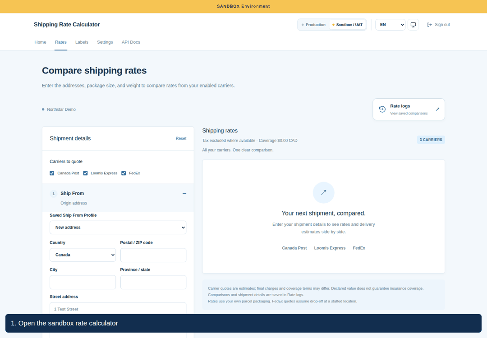

## 1. Sign in and choose an environment

Use the account created by your administrator. There is no public registration. When signing in after a session expires, the app returns you to the protected page you requested.

- **Sandbox / UAT** is the test area. Its pages display a full-width Sandbox banner.
- **Production** uses separately configured live carrier credentials.
- The environment switch shows only the areas your account can access. Switching areas does not copy carrier credentials.

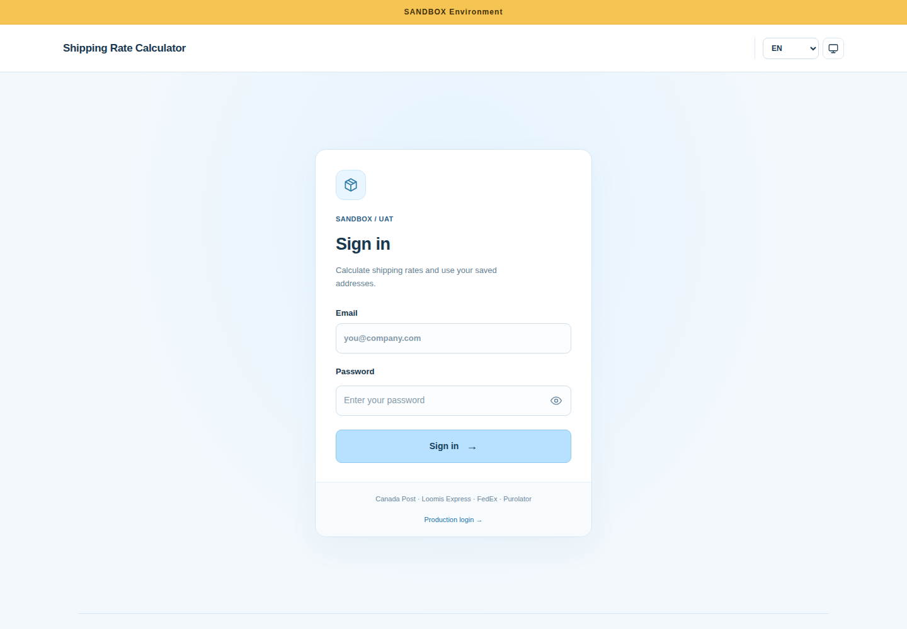

| Destination | Production | Sandbox / UAT |
| --- | --- | --- |
| Home | `/home` | `/sandbox/home` |
| Compare rates | `/rate` | `/sandbox/rate` |
| Saved labels | `/labels` | `/sandbox/labels` |
| Settings | `/setting` | `/sandbox/setting` |
| API documentation | `/docs` | `/sandbox/docs` |

The upper header groups environment selection, language, theme, and sign out. Page navigation sits beneath it, with the current page underlined.

## 2. Prepare a shipment

Open **Rates**. Your company’s enabled carriers appear under **Carriers to quote**; select the carriers you want to compare. If the list is empty, ask your administrator to configure and enable a connection.

### Addresses and reusable origins

Enter **Ship From** and **Ship To** independently. Canadian postal-code suggestions automatically populate city and province when available; you can correct either field. The collapsed address summary shows province, city, and postal code. Suggestions do not verify the complete delivery address.

Use the map icon beside **Ship To** to open the current destination fields in Google Maps. It does not create a shipment or booking.

For a recurring origin, open **Save profile**, enter a profile name, and choose **Save profile**. Choose it from **Saved Ship From Profile** on future shipments. **Set default** loads that origin automatically. Origin profiles belong to your account; company carrier connections are shared.

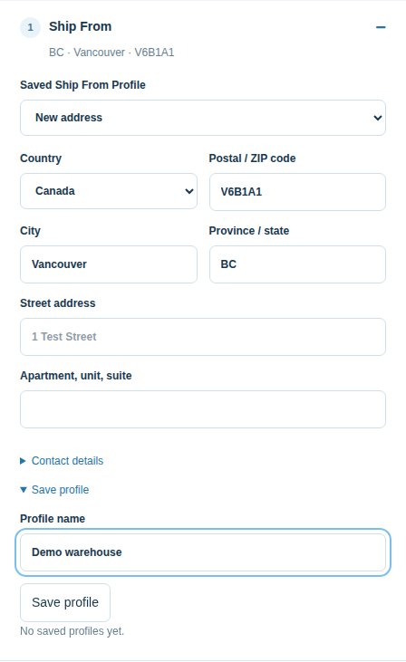

### Boxes, measurements, and options

| Field | Default | How it is used |
| --- | --- | --- |
| Boxes | 1 | Number of identical boxes; current multi-box support is limited to Purolator |
| Weight | 1 lb | Weight of each box; Purolator receives the combined shipment weight |
| Length, width, height | 0 in | All zero omits dimensions; otherwise enter a positive value for all three |
| Units | Imperial | Switching to Metric converts the entered measurements |
| Signature | Selected | Requests signature where supported by the carrier |
| Declared value | Empty | Enter a CAD amount to compare eligible covered and uncovered rates |

Boxes and weight share one row; dimensions occupy the next. Use accurate measurements: omitted dimensions may change the final charge. The web form substitutes 1 for blank or zero weight when quoting; the JSON API requires positive weight. Values round upward to two decimal places.

Choose the ship date and review signature and declared value before clicking **Compare rates**. Declared value does not guarantee insurance coverage; carrier terms apply. Integrations without multi-box support return unavailable for multiple boxes.

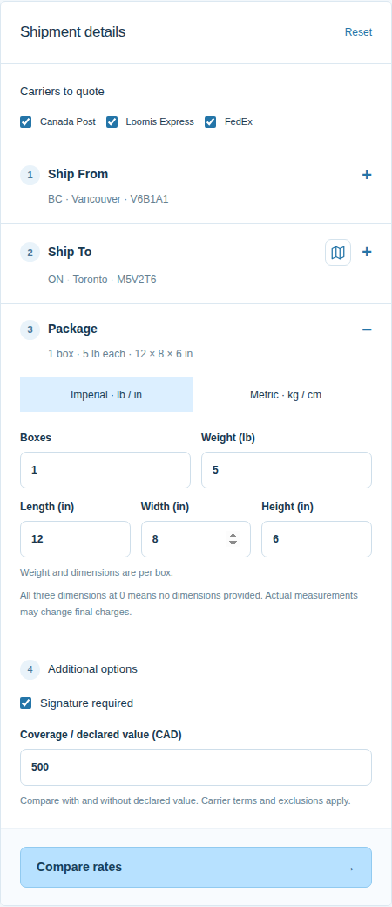

## 3. Compare services and share the result

Review carrier statuses before choosing a service. One carrier can fail while others return usable quotes. No synthetic price is substituted for a failed live API request.

The comparison shows service names, delivery estimates, signature information, and eligible coverage prices. Use **Sort rates**, **Include tax**, **Quote details**, and **Show / hide services** to focus the comparison.

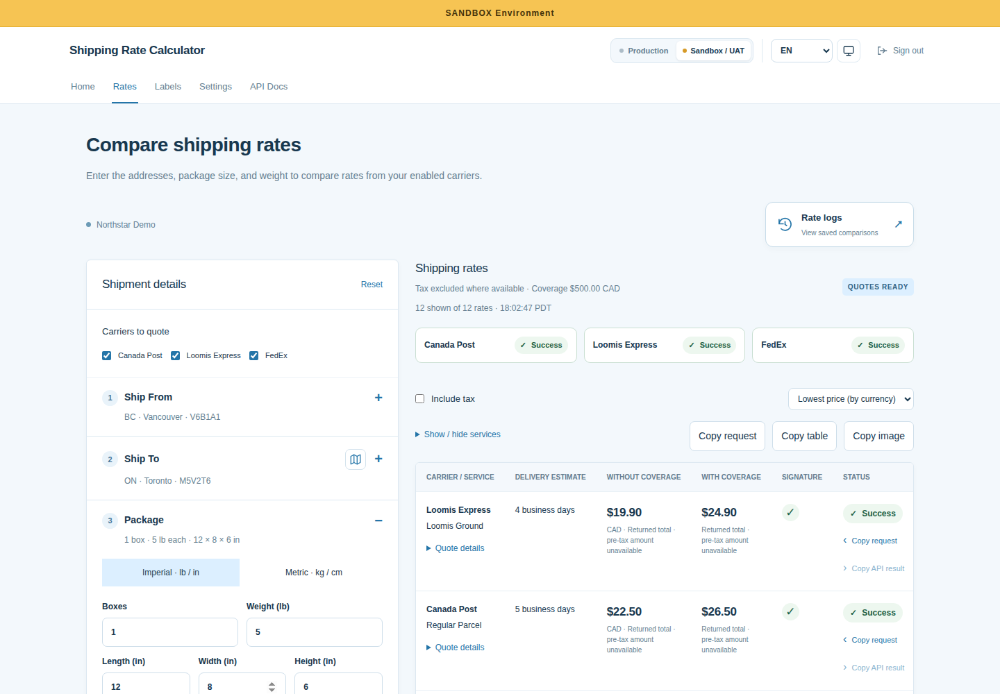

| Action | Result |
| --- | --- |
| **Copy table** | Copies the visible comparison for pasting into a message or document |
| **Copy image** | Downloads the complete page as a JPG |
| **Copy request** | Copies the submitted calculator shipment JSON for the comparison or a service’s carrier |
| **Copy API result** | Copies the available original per-service response as JSON |

Copy feedback appears in a toast. Request copies use the submitted shipment snapshot, so editing the form does not silently change the request being shared. Authentication secrets and headers are excluded.

**Editing shipment fields keeps the existing comparison visible.** Click **Compare rates** again to obtain prices for the updated details. Labels can only be generated from shipment details matching the quoted request.

## 4. Reopen a saved comparison

Each valid rate comparison is recorded in your company’s **Rate logs**. Open the dialog from the Rates page and select a record to review its route, package, returned prices, and carrier statuses.

Choose **Load shipping details** to restore the shipment and compare current rates. A past ship date moves to today; disabled carriers and personal profile access are respected. Loading a record does not promise the historical price is still available.

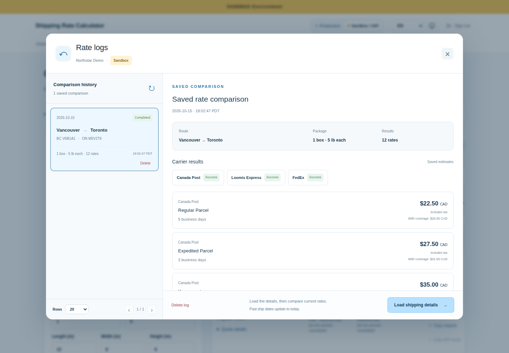

You can delete an individual log after confirmation. This removes the saved comparison for the company and leaves shipping labels intact. Rate logs remain with the company when an account is removed or reassigned.

## 5. Generate and revisit a sandbox label

Label generation is **disabled by default**. An administrator must enable it for the company and carrier environment. Current generation supports **Loomis Sandbox only**.

1. Obtain a successful live Loomis sandbox quote using complete shipment details.
2. Choose **Generate label** on the relevant service and confirm the action.
3. Only that row shows generation progress. The PNG downloads and is saved to the company’s label history.
4. Open **Labels**, then select the shipment row or its view link to open the detail page.
5. Review shipment details, view the label, or download it again.

The Labels table supports 10, 20, 50, or 100 rows per page. Labels appear on their dedicated page rather than below the rate table.

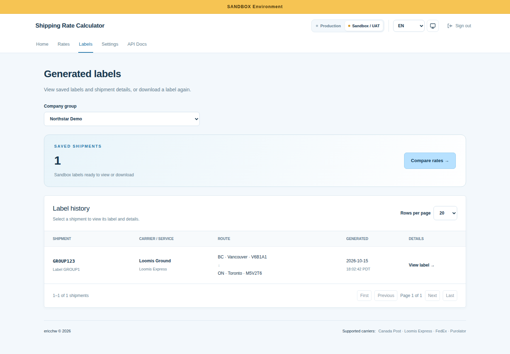

The record above demonstrates label history navigation only. Its image is a fixture, not a printable carrier waybill. The guide capture blocks waybill creation and production API calls.

## 6. Manage the company workspace

Administrators use **Settings → Company groups** and **Settings → Users and access**. Ordinary users see personal settings and their company membership; they cannot edit carrier credentials or create accounts.

| Setting | Scope |
| --- | --- |
| Carrier connections | Shared by the company, separately for each environment |
| Generation permission | Company and environment; disabled initially |
| Labels and rate logs | Shared company history |
| Origin profiles | Personal to the user |
| Language and theme | Browser preference, shared across the two carrier areas |

<strong>Company groups and carrier setup</strong>

Select or create a company, then use its tabs to manage members, connections, and permissions. A user belongs to one company; changing membership revokes that user’s sessions. Existing labels, logs, and credentials stay with the original company.

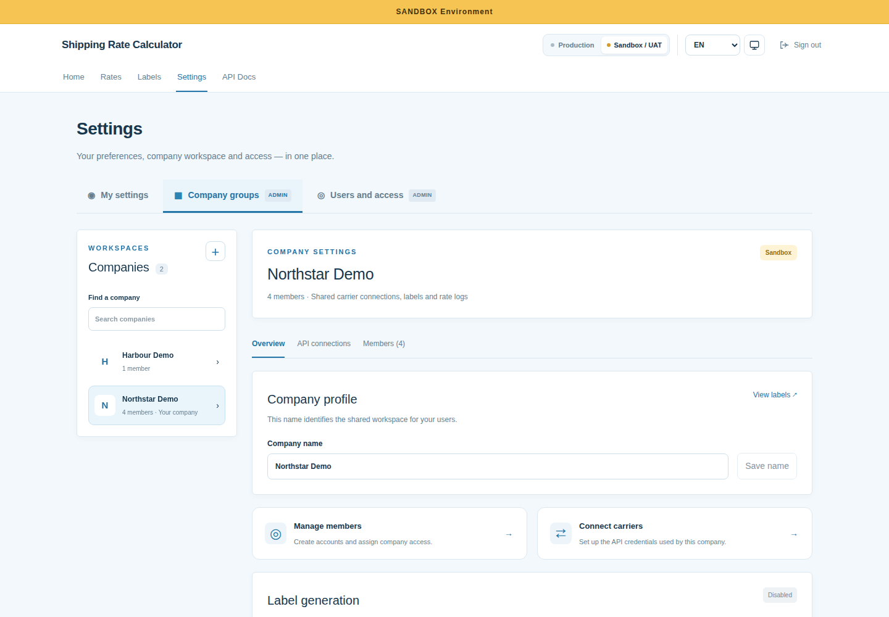

In **API connections**:

1. Enter the credentials issued for the selected carrier environment.
2. For Canada Post, choose the appropriate counter/retail or commercial account rate type.
3. Enable the carrier and choose **Save settings**.
4. Use **Test connection** to inspect status, response time, and errors. This check requests rates; it does not purchase a label.

Blank secret fields preserve stored secrets. **Clear settings** changes the draft; save to persist it. Unsaved changes trigger a leave-page prompt. Disabled but configured carriers can still be tested.

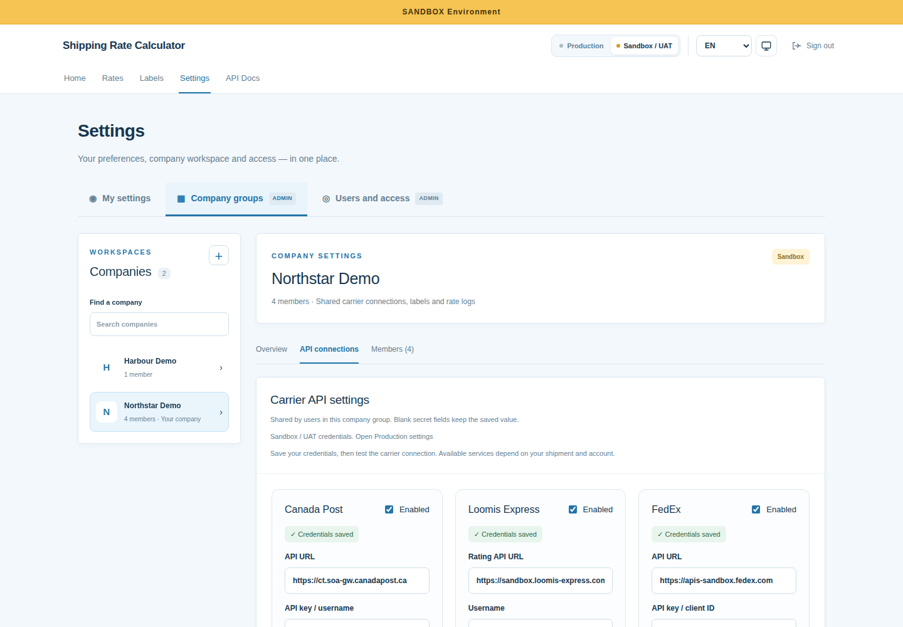

Purolator fields follow the issued credential order: Client ID, Client Secret, Key, Sender Account, Receiver Account, and Freight Account. Production requires `x-api-key`; UAT can omit it if none was issued, subject to carrier acceptance. Current Courier estimates bill the sender; receiver billing and freight quoting are not implemented.

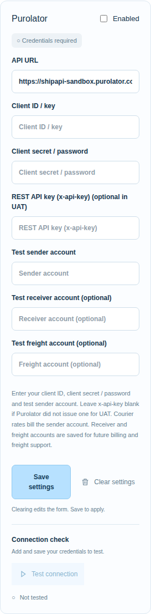

<strong>Users, roles, and access</strong>

Create accounts, assign a company, set a role, reset passwords, and independently grant Web/API and Production/Sandbox access. Enable Web access for browser users. Account access changes revoke existing sessions; affected users sign in again. The last web-enabled administrator is protected.

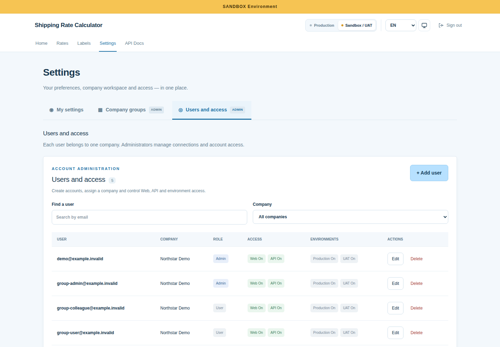

## 7. Use your preferred language, theme, and device

Choose **EN**, **FR**, **繁體中文**, or **简体中文** from the header. Switching language preserves shipment inputs and the current comparison. Carrier responses, service names, addresses, and copied API JSON retain their original values. Date/time region is configured separately in **My settings**.

Theme defaults to the operating system preference. The icon button cycles **System → Dark → Light → System**. Preferences persist in the browser and synchronize across tabs.

<strong>Preview dark mode and Traditional Chinese</strong>

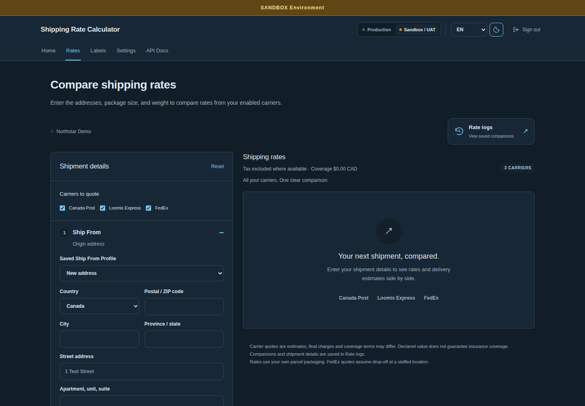

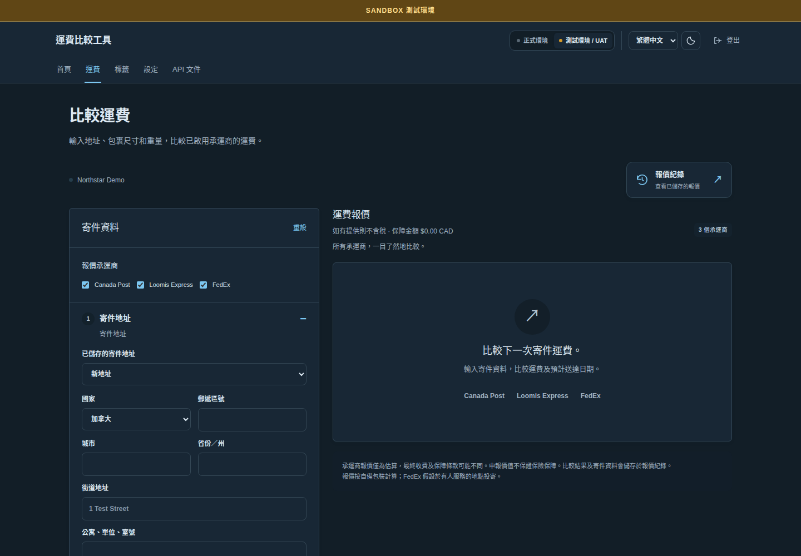

On a phone, workspace controls stay grouped, sign out uses an icon, and page navigation can scroll horizontally. Address sections can collapse; the comparison table can scroll to show additional columns.

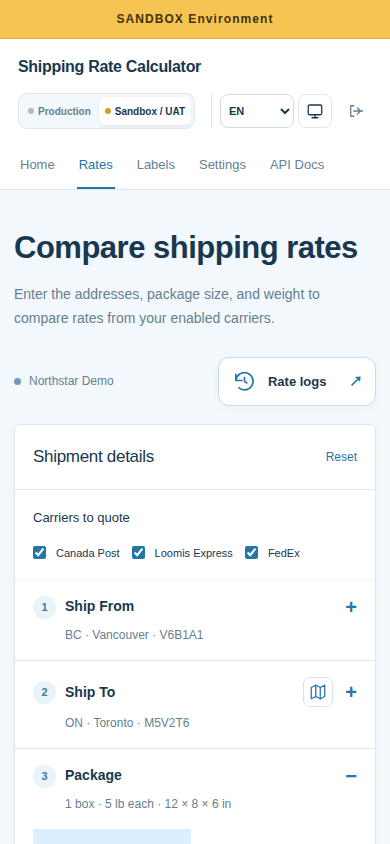

## If something needs attention

| Situation | Next step |
| --- | --- |
| No carrier choices | Ask an administrator to enable company connections in the current environment |
| A carrier fails | Review its status and connection test; correct credentials or shipment fields and retry |
| Multi-box rates unavailable | Use a supported integration or quote one box; unsupported carriers do not quote a single-box substitute |
| Generate label is missing | Check company permission, Sandbox mode, live Loomis success, and unchanged shipment details |
| A quote looks out of date | Compare again; historical and displayed rates are estimates |
| Session expired | Sign in again; account changes can also revoke sessions |

For implementation and setup details, see the [README](../README.md), [API reference](API.md), [carrier mapping](CARRIER_MAPPING.md), and [testing guide](TESTING.md).
